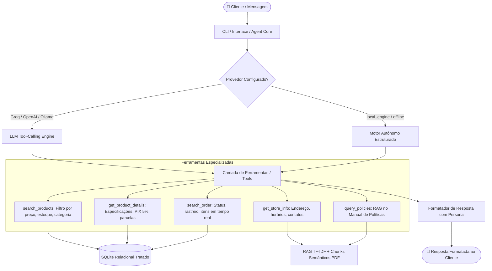

# 🎸 Empório da Música — Agente Inteligente de Atendimento

[](https://www.python.org/)
[](LICENSE)
[-brightgreen.svg)](tests/test_agent.py)
[]()

> Protótipo desenvolvido para o **Desafio Técnico de AI Engineer na Artefact**.  
> O agente atua no atendimento ao cliente da **Empório da Música**, loja tradicional de instrumentos musicais fundada em 2008 em Campo Grande/MS.

---

## 📋 Sumário
1. [Visão Geral e Persona](#-visão-geral-e-persona)
2. [Arquitetura da Solução](#-arquitetura-da-solução)
3. [Como Rodar o Projeto](#-como-rodar-o-projeto)
4. [Provedores de Modelo Suportados](#-provedores-de-modelo-suportados)
5. [Justificativa das Decisões Técnicas](#-justificativa-das-decisões-técnicas)
6. [Exemplos de Interação (Entregável 3)](#-exemplos-de-interação-entregável-3)
7. [Limitações Conhecidas e Próximos Passos](#-limitações-conhecidas-e-próximos-passos)
8. [Uso de Assistentes de Código (Workflow)](#-uso-de-assistentes-de-código-workflow)

---

## 🎯 Visão Geral e Persona

A **Empório da Música** enfrenta uma sobrecarga no time humano devido a dúvidas recorrentes sobre catálogo, especificações, preços, cálculo de parcelamento, prazos de entrega e políticas de devolução.

### 🎭 Persona do Agente
- **Tom de voz**: Amigável, acolhedor e atencioso — comunica-se como um músico experiente e cordial que entende a fundo do assunto e tem paixão pela música, preservando o respeito e a cordialidade.
- **Foco Exclusivo da Loja**: A loja comercializa **exclusivamente instrumentos musicais** (violões, guitarras, contrabaixos, baterias, teclados/pianos, instrumentos de sopro e cordas orquestrais). **Não vende acessórios** (palhetas, cordas avulsas, cases, cabos, pedais ou amplificadores). Quando questionado sobre acessórios, o agente esclarece a política com gentileza e orienta a busca em lojas parceiras.
- **Fidelidade Factual**: O agente **nunca alucina** preços, promoções ou disponibilidade. Ele consulta compulsoriamente os dados operacionais estruturados e as políticas oficiais.

---

## 🏗️ Arquitetura da Solução

O projeto implementa uma **Arquitetura Híbrida de Dois Níveis**:
1. **Nível LLM com Tool-Use (Function Calling / ReAct)**: Compatível com o padrão OpenAI Chat Completions (Groq, OpenAI, Ollama), permitindo que modelos de linguagem raciocinem e convoquem ferramentas especializadas em tempo real.
2. **Nível Motor Autônomo Local (Fallback Determinístico)**: Permite que **qualquer avaliador clone o repositório e teste 100% das funcionalidades imediatamente**, sem precisar cadastrar cartão ou gerar chaves de API pagas.



---

## 🚀 Como Rodar o Projeto

### 1. Clonar o Repositório e Criar Ambiente Virtual

```bash
git clone https://github.com/aldeisebarbosa/desafio_Artfact_AIEngineer.git
cd desafio_Artfact_AIEngineer

# Criação do ambiente virtual
python -m venv .venv

# Ativação do ambiente virtual (Windows PowerShell)
.venv\Scripts\Activate.ps1

# Ativação do ambiente virtual (Linux / macOS)
# source .venv/bin/activate
```

### 2. Instalar Dependências

```bash
pip install -r requirements.txt
```

### 3. Executar o Chat Interativo (CLI)

```bash
python main.py
```
> O modo interativo permite conversar livremente com o agente, testar perguntas e usar comandos como `ajuda`, `exemplos`, `limpar` e `sair`.

### 4. Executar Consulta Direta via Argumento

```bash
python main.py --query "Quanto custa o Takamine GD20?"
```

### 5. Executar a Bateria de Cenários de Teste

```bash
python main.py --run-examples
```

### 6. Executar os Testes Automatizados

```bash
python -m unittest tests/test_agent.py
```

---

## 🔌 Provedores de Modelo Suportados

Por padrão, o agente roda no modo `local_engine` (gratuito e sem necessidade de chaves). Se você preferir usar um modelo em nuvem ou local via Ollama, configure o arquivo `.env`:

Copie o `.env.example` para `.env`:
```bash
cp .env.example .env
```

| Provedor | Variável de Ambiente | Modelo Padrão | Exemplo de Execução |
| :--- | :--- | :--- | :--- |
| **Local Engine** (Padrão) | Nenhuma necessária | Motor Híbrido Determinístico | `python main.py --provider local_engine` |
| **Groq** (Ultrarrápido) | `GROQ_API_KEY` | `llama-3.3-70b-versatile` | `python main.py --provider groq` |
| **OpenAI** | `OPENAI_API_KEY` | `gpt-4o-mini` | `python main.py --provider openai` |
| **Ollama** (Local) | `OLLAMA_BASE_URL` | `llama3.2` | `python main.py --provider ollama` |

---

## 🧠 Justificativa das Decisões Técnicas

### 1. Tratamento de Dados e Migração para SQLite Relacional
- **Decisão**: Em vez de ler os arquivos `.csv` brutos em cada consulta do agente, foi construído um pipeline de ETL (`src/database.py`) que higieniza e indexa todos os dados em um banco **SQLite local** (`emporio.db`).
- **Justificativa**:
  - **Eficiência e Integridade**: Consultas SQL relacionais permitem fazer `JOIN` entre `orders`, `customers` e `order_items` de forma imediata.
  - **Normalização e Busca Textual**: Criou-se a coluna `search_blob` com remoção de acentos (`normalize_text`), garantindo que buscas por "violao" encontrem "Violão" sem falhas de encoding.
  - **Pré-cálculo de Regras Comerciais**:
    - **Regra Seção 6.2 (PIX)**: Desconto de 5% à vista aplicado sobre o valor original, **mas não cumulativo** com promoções ativas.
    - **Regra Seção 3.1 (Parcelamento Cartão)**: Cálculo dinâmico do número máximo de parcelas sem juros respeitando os pisos mínimos (7x a 12x: mínimo de R$ 100/parcela; 4x a 6x: mínimo de R$ 80/parcela; até 3x: compras acima de R$ 50).

### 2. Retrieval de Políticas via RAG Semântico Estruturado (PDF)
- **Decisão**: Chunking semântico estruturado por seções do manual (`src/policies.py`) combinado com vetorização `TfidfVectorizer` e similaridade de cossenos.
- **Justificativa**:
  - Evita a dependência de serviços externos de embeddings pagos apenas para consultar um documento fechado de 10 páginas.
  - O particionamento estruturado preserva a integridade de tabelas de prazos (ex.: 7 dias CDC Artigo 49, 30 dias garantia interna da loja).

### 3. Arquitetura de Ferramentas (Tool-Use / Function Calling)
- **Decisão**: 5 ferramentas desacopladas e descritas com schemas JSON estritos (`AVAILABLE_TOOLS_SPEC`).
- **Justificativa**:
  - Separação clara de responsabilidades: o modelo raciocina sobre qual dado precisa e a ferramenta executa a lógica de banco/regras de negócio com precisão matemática.

---

## 💬 Exemplos de Interação (Entregável 3)

O repositório inclui **5 transcrições completas** cobrindo os cenários solicitados no edital na pasta [`examples/`](examples/):

1. **[`01_consulta_catalogo_violoes.md`](examples/01_consulta_catalogo_violoes.md)**:
   - Consulta: *"Quais opções de violões disponíveis custando até R$1000?"*
   - Demonstra: Filtro de categoria, teto de preço, estoque ativo, desconto no PIX e parcelas sem juros.
2. **[`02_informacoes_loja_e_horarios.md`](examples/02_informacoes_loja_e_horarios.md)**:
   - Consulta: *"Qual o endereço da loja?"* e funcionamento em finais de semana.
   - Demonstra: Informações cadastrais oficiais e políticas de horário em Campo Grande/MS.
3. **[`03_consulta_preco_takamine_gd20.md`](examples/03_consulta_preco_takamine_gd20.md)**:
   - Consulta: *"Quanto custa o Takamine GD20?"*
   - Demonstra: Preço de tabela (R$ 2.199,00), PIX com 5% (R$ 2.089,05), parcelamento máximo em até 12x de R$ 183,25 sem juros e estoque em tempo real (5 unidades).
4. **[`04_politica_devolucao_e_arrependimento.md`](examples/04_politica_devolucao_e_arrependimento.md)**:
   - Consulta: *"Me arrependi da minha compra, posso devolver meu pedido?"*
   - Demonstra: Aplicação da Seção 4.0 das políticas e Artigo 49 do CDC (7 dias corridos, frete reverso gratuito e estorno integral em até 10 dias úteis).
5. **[`05_rastreamento_pedido_e_fora_de_escopo.md`](examples/05_rastreamento_pedido_e_fora_de_escopo.md)**:
   - Situação Não Trivial: Consulta em tempo real aos dados do Pedido #1 (Pedro Henrique Oliveira, código de rastreamento `BRAB1234567BR`, Martin D-28) + tratamento de pergunta fora de escopo (tentativa de inclusão de palhetas e encordoamento).

---

## ⚠️ Limitações Conhecidas e Próximos Passos

Caso houvesse mais tempo de desenvolvimento, as seguintes melhorias seriam priorizadas:
1. **Banco Vetorial com Embeddings Densos**: Migrar o retriever de TF-IDF para embeddings densos multilíngues (como `bge-m3` ou OpenAI `text-embedding-3-small`) em ChromaDB ou Qdrant para consultas semânticas com paráfrases mais complexas.
2. **Persistência de Sessões em Banco de Dados**: Atualmente o histórico de mensagens é mantido em memória durante a sessão da CLI. Com mais tempo, seria implementado armazenamento persistente com SQLite/Redis com identificador de cliente (`session_id`).
3. **Interface Web Conversacional**: Criação de um frontend moderno em Next.js / Streamlit para demonstrar a experiência do cliente em dispositivos móveis e desktop.
4. **Integração com WhatsApp Business**: Conexão com webhooks de APIs de mensageria (ex.: Twilio, Z-API) para atendimento omnicanal real.

---

## 🤖 Uso de Assistentes de Código (Workflow)

Conforme solicitado no edital da Artefact, documentamos com total transparência o uso de assistentes de inteligência artificial durante o desenvolvimento:

- **Assistente Utilizado**: Google Antigravity / Gemini 3.8.
- **Workflow e Aplicação**:
  1. **Análise de Requisitos e Dados**: Extração estruturada do PDF de políticas da loja e inspeção das anomalias nos CSVs de dados operacionais (promoções expiradas vs ativas, formatos de data, campos nulos).
  2. **Pair Programming e Implementação**:
     - Auxílio na escrita do pipeline de limpeza e migração relacional SQLite (`src/database.py`).
     - Codificação do retriever RAG semântico (`src/policies.py`).
     - Construção da suíte de testes unitários automatizados (`tests/test_agent.py`).
  3. **Validação e Edge Cases**: Descoberta e correção proativa de casos de borda (como palavras de parada que colidiam com buscas de produtos e tratamentos de telefones parciais em consultas de pedidos).

---

## 📄 Licença

Este projeto está licenciado sob os termos da licença [MIT](LICENSE).
